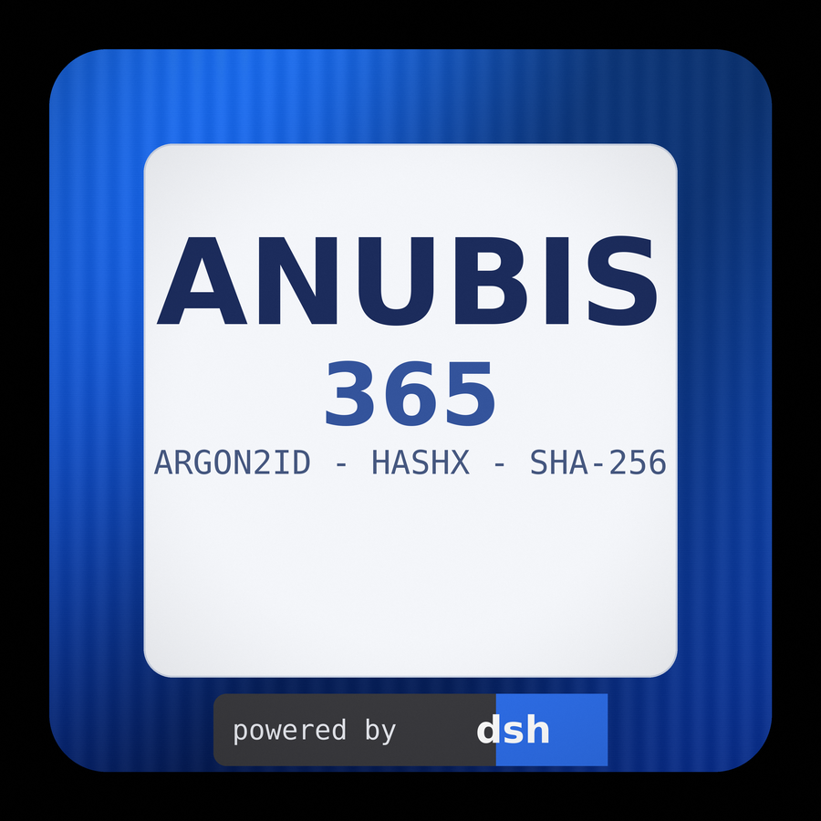
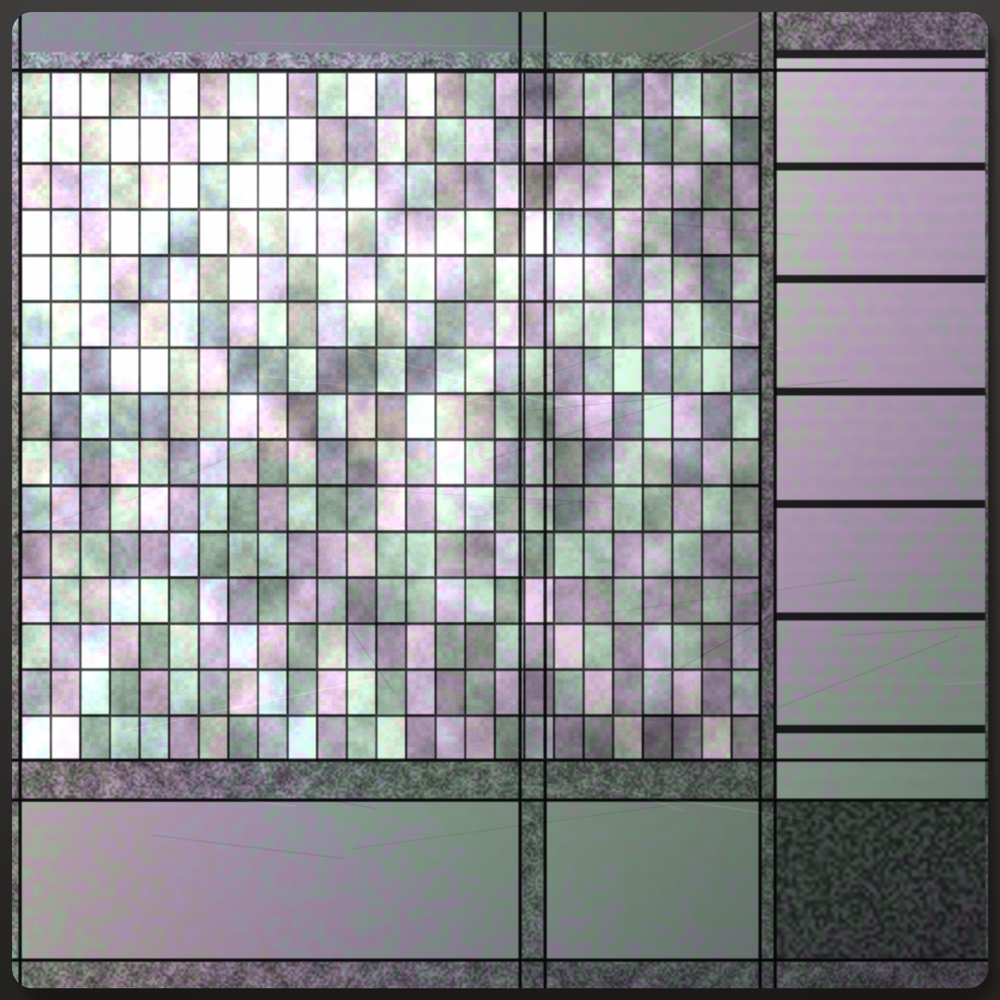
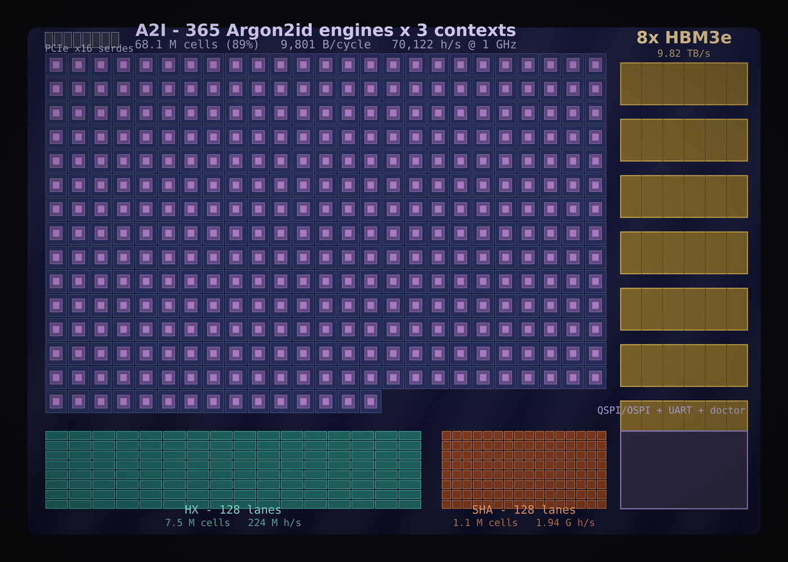

# anubis-solver

[](https://pypi.org/project/libanubis-solver/)
[](https://pypi.org/project/libanubis-solver/)

> **Wanted: a live `soteria` sample.** Upstream Anubis documents a `soteria`
> challenge — a SIMD wasm one — but registers no implementation for it, so there is
> nothing in that tree to port and nothing to measure
> ([`betterAnusbis/PARITY.md`](betterAnusbis/PARITY.md)). **If you find a site that
> actually issues one, open an issue with the URL** and it can be reverse engineered
> from the wire format and supported like the other seven tiers.
>
> Useful, in this order: the URL; the challenge JSON — the `{"challenge": …,
> "rules": …}` block, or what `POST /api/make-challenge` answers; the Anubis version,
> or the hash of the served JS; and whether you are happy for the host to be named in
> the issue. **Please do not paste cookies, auth headers, or anything from a
> logged-in session** — the challenge is public and is the only part needed, and one
> request is enough.

`pip install libanubis-solver` (the PyPI name `anubis-solver` is an unrelated
project; the import name is `anubis_solver` either way).

<br>
<sub>Generated by ChatGPT</sub>

**2.40 "shyleaf"** — the tier that pays. `meatrider` is SHA-256, twice, over a
real 80-byte Bitcoin block header rebuilt from the challenge: sixteen rungs
priced at what an Antminer S21 Pro would earn doing the same hashes, from a
femtocent (two milliseconds of browser) to **$1.33** — 2.7 ASIC-hours, or 73,000
years of one browser tab. The gate can escalate by itself (the honeypot's hit
count picks the rung, one wall up per doubling), publish the price as a
`bitcoin:` link, and accept an operator-issued receipt so a payer can buy past
the rungs only an ASIC can mine. The address is the operator's and no code path
pays anyone else: no fee, no subscription, no cut. [EVOLUTION.md](EVOLUTION.md)
is the thirteen-day story that led here — and where three misquoted cells in the
Argon2id GPU tables got re-derived from their JSONs. Everything from 2.0.2 is
still here, including the one `.so` that runs on a T4, an Arc, an AMD card, a
TPU VM or a bare CPU.


<table>
<tr>
<td align="center"><br>
<sub>the badge</sub></td>
<td align="center"><br>
<sub>the die, delidded</sub></td>
<td align="center"><br>
<sub>floorplan: 365 Argon2id engines + 8x HBM3e</sub></td>
</tr>
</table>

## Max speed, on scraps

No datasets, no clusters, no megawatts. The whole project runs on what was lying
around: one laptop, a borrowed TPU, a free T4 on Kaggle, 69 scraped pages, 77
probed hosts, one solved challenge at a time.

That constraint is the design. Every kernel here is sized to what fits in L1 and
in a register file, not to what fills a rack: hand-written AVX-512 and SHA-NI, a
wasm module four nonces wide, a `.so` 22x smaller than the server it talks to and
half the CPU per request. "Max speed" means **throughput per joule, per euro and
per byte of footprint** — never throughput per dollar of capital expenditure.

The rule for every number in this repository: reproducible from a command in this
file, on hardware you can borrow, and published even when it loses.
[`SPEED.md`](SPEED.md) carries the negative results next to the 700 MHash/s one —
Argon2id on a TPU is 3.8x *slower* than a single CPU core, and it is in there with
the same prominence, because a benchmark suite that only publishes wins is a
press release.

A summary of what this repository demonstrates, with the measured numbers and how
to reproduce each one, is in [`SHOWCASE.md`](SHOWCASE.md).

**Beyond** is the hardware half of this repository, in [`beyond/`](beyond/). It is a
real design point: 365 Argon2id engines
x 3 contexts behind eight HBM3e stacks (70,122 h/s measured), plus 128 HashX
lanes, 128 SHA-256 lanes and a self-test. Renders are generated by
`beyond/tools/render_chip_art.py` from the measured numbers, not drawn by hand.

A C proof-of-work engine with a Python face, for solving
[TecharoHQ/anubis](https://github.com/TecharoHQ/anubis) challenges. It does the
same flow a browser does — fetch the challenge page, compute the proof-of-work,
GET `pass-challenge`, keep the auth cookie — with the hot loops in hand-written
assembly and optional GPU backends.

> **Built entirely by [DeepSeek V4.1 Flash](https://huggingface.co/deepseek-ai/DeepSeek-V4.1-Flash-1017)**
> in [DeepSeek Harness (DSH)](https://github.com/deepseek-ai/deepseek-harness).

> **Authorized use only.** Running this against a site circumvents the bot
> mitigation its operator deliberately installed. Use it on systems you own or
> have explicit permission to test. See [SECURITY.md](SECURITY.md).

## SHA-256 in Scratch blocks

A Scratch 3 project is a graph of blocks; one of them in [`scratch/`](scratch/) is
SHA-256, written in blocks, with no JavaScript, no extension and no compiled-mode
trick. It is the "scraps" theme taken literally — a children's block language
running a real proof of work — and it forced two workarounds worth knowing:

- **No bitwise operators.** Scratch has `+ - * / mod floor` and nothing else: no
  `xor`, no `and`, no shifts. A 32-bit word fits a double exactly, so add, rotate,
  shift and not are plain exact arithmetic; the bitwise three have no arithmetic
  form and become 16x16 limb tables, eight list lookups per 32-bit xor.
- **No return values.** A custom block is a *statement*; a call in an input slot
  runs and evaluates to nothing (verified against the real VM: the callee ran, its
  global held the result, the receiver was `undefined`). So the port has no
  functions, only a global, and every expression containing a call is flattened
  into statements with temporaries.

On a 64-byte Anubis challenge (68-byte input, two blocks):

| runtime | hashes/s | difficulty 21 (2,097,152 hashes) |
|---|---|---|
| `scratch-vm`, the reference interpreter | **25** | ~23 h |
| TurboWarp in a browser (compiles blocks to JS) | **1,708** | ~20.5 min |
| the same blocks compiled to WebAssembly | 2,100-2,600 | ~14 min |

The last row is a companion compiler that lives outside this repository, so it is
not reproducible from a command here; the first two are.

It is not a toy hash. The project asks for a challenge, searches the nonce space,
and reports rate and ETA while it works, and Anubis *accepts* the proof. At
difficulty 12 it found nonce 7581 after 7,582 hashes, `pass-challenge` answered
`302` with the auth cookie, and the server logged `challenge accepted`. At
difficulty 20 — five leading zero nibbles — a TurboWarp tab found
**nonce 1,016,595 in 595.7 s at 1,708 H/s**: 97% of the 2^20 expected hashes, so
an ordinary draw rather than a lucky one. Twenty test vectors match `hashlib`,
including the lengths that break padding (55/56/57/63/64/65/119/120), multi-block
input and all 256 byte values.

```bash
cd scratch && make && make test           # 20 vectors against hashlib
cd scratch && make bench                  # where the microseconds go
python3 scratch/tools/scratch_pow.py --port 8080   # fetch, solve, submit, re-fetch
```

[`SPEED.md`](SPEED.md#sha-256-in-scratch-blocks-the-slow-end) carries the full
numbers, including why compiling the same blocks to wasm only buys ~1.0-1.6x over
TurboWarp's JavaScript compiler: the wall is doubles pretending to be integers, not
dispatch. [`scratch/README.md`](scratch/README.md) has the whole cost model: one block
statement costs about a microsecond, which is what decided the design (constants
folded into reporters, the limb loop unrolled). The project itself is
[`scratch/build/sha256.sb3`](scratch/build/sha256.sb3) — 30 KiB, opens in
TurboWarp, green flag, paste a challenge.

## The C services (since 2.0.1)

Two binaries, one shared C client, no scripting runtime:

| binary | what it is | docs |
|---|---|---|
| `anubis_mcp` | MCP server over stdio: tools `anubis_fetch`, `anubis_fetch_raw`, `anubis_dump_headers`, `anubis_solve`, `anubis_solve_raw`, `anubis_version`, `anubis_backends` | [docs/mcp.md](docs/mcp.md) |
| `anubis_api` | HTTP/1.1 JSON service: `/v1/solve`, `/v1/solve_raw`, `/v1/verify`, `/v1/fetch`, `/v1/fetch_raw`, `/v1/dump_headers`, `/v1/backends` | [docs/api-service.md](docs/api-service.md) |

```bash
make -j8 libanubis_solver.so
make services                 # anubis_api + anubis_mcp
./anubis_api --listen 127.0.0.1:8088
```

Both are built on [`src/fetch/`](src/fetch/), which is part of the `.so` as of
2.0.1: fetch the page, read the `anubis_challenge` JSON, solve it with the
solver (every algorithm, including `tensor` and the time-based tiers), submit
`pass-challenge` with the cookies the server set, and re-fetch. TLS is verified,
with two clients:

- **browser impersonation**, through
  [curl-impersonate](3rd_party/curl-impersonate/README.md): Chrome's cipher
  list, extension order, ALPN h2 and GREASE values. Loaded with `dlopen()` at
  runtime, so it is optional and never a build dependency. Measured against
  `tls.peet.ws`, the impersonated client presents
  `ja4 t13d1516h2_8daaf6152771_e5627efa2ab1` and `ja3
  fd09e6880f085c6348aecbfe10e30e8a` — Chrome 116's — while the fallback presents
  OpenSSL's `http/1.1` handshake. Pick a profile per request
  (`chrome`, `chrome116`, `edge101`, `safari15_5`), per process
  (`ANUBIS_IMPERSONATE`), or turn it off;
- **the built-in OpenSSL client**, HTTP/1.1 only, for when no such library is
  installed or the target is local.

```bash
make test-api test-mcp        # start a local gate, solve through both layers
make test-impersonate         # local TLS server: GREASE present/absent per profile
```

## Highlights

- **All five Anubis algorithms**: `fast`, `slow`, `sha256` (WASM), `argon2id`
  (WASM) and `hashx` (WASM), byte-exact against every Anubis release.
- **A sixth, ours: `tensor`** — one integer int8 GEMM whose digest is the
  proof, run in the browser on WebNN, on a wasm kernel, or in plain JavaScript.
  The one tier where acceleration is the point rather than a bonus.
- **`tensor-v`, the sampled proof** — same GEMM, but the client commits to the
  output with a Merkle root and opens only the 96 blocks the server picks after
  seeing the root, from a server secret. The server checks those elements instead
  of recomputing the product, so its cost stops being `O(N^3)`: a few milliseconds
  at difficulty 16 against the client's several hundred (measured: 3.6 ms vs
  538 ms in wasm, ~1:150), and a client that skipped a fraction `f` of the matrix
  still passes only `f^96` of the time. See
  [the section below](#tensor-and-tensor-v-the-two-tiers-that-are-ours) and
  [betterAnusbis/SECURITY-REVIEW.md](betterAnusbis/SECURITY-REVIEW.md#tensor-v-sampled-verification).
- **A ninth, `meatrider`**: SHA-256, twice, over a real 80-byte Bitcoin block
  header rebuilt from the challenge, with the work priced in bitcoin — from a
  femtocent (two milliseconds of browser) to **$1.33, which is 2.7 hours of an
  Antminer S21 Pro and 73,000 years of one browser tab**. The address it pays is
  **yours**: no fee, no subscription, no cut to anyone. See
  [the ladder below](#meatrider-proof-of-work-priced-in-bitcoin).
- **CPU kernels**: hand-written AVX2, SHA-NI, AVX-512 and AArch64 NEON/SHA-2
  assembly, with runtime dispatch down to a portable C fallback.
- **GPU backends** (all opt-in except SHA-256): CUDA, oneAPI Level Zero,
  Vulkan and OpenCL — for SHA-256, Argon2id and HashX. The OpenCL path now
  actually runs: 265 M hashes/s on an Iris Xe through Intel's NEO ICD, 13x what
  four CPU threads manage on the same challenge (see [docs/gpu.md](docs/gpu.md)).
- **One `.so`, every machine (new in 2.0.2)**: `make universal` compiles CUDA,
  Level Zero, Vulkan, OpenCL and TPU in; the library probes what is present and
  uses it, so the same file runs on a T4, an Arc, an AMD card, a TPU VM or a
  bare CPU. Every vendor driver is `dlopen()`ed, cudart included.
- **Three interfaces**: Python library + CLI, a public C/C++ header, and the
  shared library on its own.
- **Browser TLS impersonation in C**: the fetch layer inside the `.so` speaks
  Chrome's handshake (JA3/JA4-identical to Chrome 116, verified against
  `tls.peet.ws`) using a `dlopen()`ed libcurl-impersonate, and falls back to its
  own OpenSSL client when none is installed. No BoringSSL in the build.
- **Two C services (new in 2.0.1)**: an **MCP server** over stdio (`anubis_mcp`)
  that lets an agent fetch Anubis-protected URLs and solve challenges, and an
  **HTTP API service** (`anubis_api`) exposing `/v1/solve`, `/v1/solve_raw`,
  `/v1/verify`, `/v1/fetch`, `/v1/fetch_raw`, `/v1/dump_headers` and
  `/v1/backends` as JSON. `solve_raw` / `anubis_solve_raw` take the raw
  challenge JSON, script element or page and return the raw `pass-challenge`
  query without touching the network.
  Both link the `.so` and the shared C
  fetch layer (`src/fetch/`), with no Python or Node in the path.
- **Every GPU hit is re-verified** with the CPU reference; a mismatch silently
  falls back, so a broken driver cannot produce an invalid proof.
- **Seven language bindings** over the same `.so`: Node, Go, C#, R, Java, Rust
  (hand-written FFI, no bindgen) and assembly on x86-64 and AArch64.
- **WebAssembly kernels** that beat the modules Anubis ships: SHA-256 four nonces
  wide at **2.1x**, HashX compiled from the challenge at **7-8x**, Argon2id at
  **1.02-1.05x**. All bit-exact against the C reference and against Anubis's own
  modules, which are asked to accept our answers.
- **Two ways to put the wall up**: `betterAnusbis/`, an Anubis-compatible gate in
  one C file (every algorithm, the honeypot included), and
  `firefox-extension/`, which lets the browser solve with the native library over
  native messaging — **10x** the in-page wasm at difficulty 20.
- **`libanubis_solver.so` is 22x lighter than Anubis's server and half the CPU**
  per request, measured from `/proc`.
- **A readable site in [`web/`](web/)**: the beginner walkthrough, the six
  algorithms, the comparison against Anubis, the benchmark tables and a page of
  the claims that measurement proved wrong. Static HTML, no build step:
  `cd web && make serve`.

## Measured

Every number below is measured on this machine and reproducible from the commands
next to it; [`SPEED.md`](SPEED.md) has the full tables, the methodology and the
results that came out negative.

| | | how |
|---|---|---|
| SHA-256 in wasm, 4 nonces wide | **1.8-2.1x** Anubis's own module (3.0-3.9 vs 1.7-1.9 M hashes/s) | `cd wasm && make && node bench-sha256.mjs` |
| HashX compiled from the challenge | **7-8x** Anubis's module (2.9-3.2 vs 0.37-0.44 M hashes/s) | `cd wasm && node verify-jit.mjs` |
| SHA-256 on a TPU | **700.2 MHash/s** at 16.7M lanes, 84x one CPU core | [`src/google/tpu/sha256_pjrt.c`](src/google/tpu/sha256_pjrt.c), [SPEED.md](SPEED.md#tpu-the-sha256-tier-700-mhashs) |
| HashX on a TPU | **284.6 MHash/s** on one TPU device, 29x one CPU thread | [`src/google/tpu/hashx_pjrt.c`](src/google/tpu/hashx_pjrt.c), [SPEED.md](SPEED.md#hashx-on-a-tpu-colab-pjrt) |
| Argon2id on a TPU | **9.4 H/s** at 32 lanes, **3.8x slower** than one CPU core - the dependency chain wins | [`src/google/tpu/argon2_pjrt.c`](src/google/tpu/argon2_pjrt.c), [SPEED.md](SPEED.md#tpu-argon2id-the-chain-is-the-wall) |
| Argon2id, whole hash | **1.02-1.05x** Anubis's module (65-75 vs 68-76 ms/hash) | `cd wasm && make verify-module` |
| Argon2id fill core | parity with Anubis (~1.5-1.9 µs/block) | `cd wasm && node bench-a2i.mjs` |
| Browser, native library | **10x** the in-page wasm at difficulty 20 | `python3 firefox-extension/test-native.py` |
| Gate server footprint | **~21x less RAM** (2.1 vs 44-46 MB), ~1.9x less CPU per request | `python3 tools/bench-server-resources.py` |
| Client memory | wasm kernel 0.13 MiB vs Anubis's 1.06 MiB | `node tools/bench-client-resources.mjs` |
| SHA-256 in pure Scratch blocks | **25 H/s** interpreted, **1,708 H/s** in TurboWarp — difficulty 20 solved in 9m56s, difficulty 21 in ~20.5 min | `cd scratch && make test` |
| `meatrider` (SHA-256d, Bitcoin header) | **0.91 MHash/s** native one core, **0.76-1.04 MHash/s** in wasm — two compressions per hash, no SHA-NI path | `python3 tools/bench_tiers.py --reps 5`, `node wasm/verify-meatrider.mjs` |
| `tensor-v` server audit | **3.6 ms** at difficulty 16, against 538 ms of client wasm commit (~1:150) | `python3 tools/bench_tensor_v.py` |
| The wall, end to end | six server x client combinations | `node tools/bench-endtoend.mjs` |

## Quick start

```bash
make                       # builds ./libanubis_solver.so
python3 -c "import anubis_solver; print(anubis_solver.__version__)"
```

```python
from anubis_solver import AnubisClient

with AnubisClient("http://127.0.0.1:8923") as client:
    r = client.get("/")            # loads, solves, retries automatically
    print(r.status_code)
```

```bash
python3 anubis_solver.py http://127.0.0.1:8923 --threads 8
python3 examples/basic.py http://127.0.0.1:8923
```

C and C++:

```c
#include <anubis-solver.h>

uint64_t nonce; char hex[65]; double ms;
anubis_solve_nibbles("challenge", 4, 0, 0, 0.0, &nonce, hex, &ms);
```

```bash
cc  demo.c   -Iinclude -L. -lanubis_solver -Wl,-rpath,"$PWD" -o demo && ./demo
c++ demo.cpp -Iinclude -L. -lanubis_solver -Wl,-rpath,"$PWD" -o demo && ./demo
```

## Documentation

New here? [BEGINNER.md](BEGINNER.md) walks from build to first request, and
[EVOLUTION.md](EVOLUTION.md) says how the thing got here.

| page | what it covers |
|---|---|
| [docs/python.md](docs/python.md) | Python API: solver, challenges, client, sessions |
| [docs/c-api.md](docs/c-api.md) | C/C++ header, C ABI, dlopen, return codes |
| [docs/cli.md](docs/cli.md) | command line |
| [docs/gpu.md](docs/gpu.md) | CUDA / Level Zero / Vulkan / OpenCL backends and env vars |
| [docs/troubleshooting.md](docs/troubleshooting.md) | common build and runtime errors |
| [docs/development.md](docs/development.md) | layout, build, kernel regeneration, tests |
| [SPEED.md](SPEED.md) | measured throughput, per tier and per version |
| [EVOLUTION.md](EVOLUTION.md) | where this began: the pirate-tool `.so`, the takedown, the chip, the GPU argument, the Radeon that got away, Scratch, meatrider |
| [MIGRATE.md](MIGRATE.md) | moving a live deployment from Anubis to `betterAnusbis`, and making clients fast while doing it |

## [HALL_OF_SHAME.md](HALL_OF_SHAME.md)

A file for claims that did not survive measurement — other people's first, because
that is funnier, then ours, because that is fairer. The headline one is the
prediction that memory-hard Argon2id puts "the 'hey Claude vibeslop me a CUDA Anubis
solver' route ... on its way to being fundamentally dead": this repository is that
solver, it was written entirely by an AI, and `results/argon2id-cuda-t4.json` has it
running Argon2id at **20.7x** a CPU core on a T4.

## Documentation site

**[celikfana-lab.github.io/anubis-solver](https://celikfana-lab.github.io/anubis-solver/)**
is a static site written for humans rather than for people who already know the
project: a beginner walkthrough that assumes nothing, the six
algorithms with what a difficulty number costs for each, a comparison against
Anubis that includes the parts where Anubis wins, every benchmark table with its
protocol, and a page listing the claims that re-measurement proved wrong.

```bash
cd web
make serve      # http://127.0.0.1:8090/
make check      # links and anchors, then layout at 390 and 1280 px
```

Six HTML files and one stylesheet — no framework, no CDN, no `npm install` to
read the docs. `make check` runs a link/anchor/id linter and a headless-Chrome
layout check, so a table that slides sideways on a phone fails a test instead of
shipping.

## Layout

### Other languages

Besides the Python library at the top of the repository, `bindings/` has thin
wrappers over the same `libanubis_solver.so`: **Node** (koffi FFI, no native
addon), **Go** (cgo), **C#** (P/Invoke, no NuGet), **R** (a `.Call` shim) and
**Java** (JNI, no jars, no preview flags), **Rust** (hand-written FFI, no
dependencies) and **assembly** (`call` on x86-64, `bl` on AArch64). All of them
expose introspection, the SHA-256 helpers, all five algorithm families and
verification, and each ships with tests that run against the real library:

```bash
(cd bindings/node   && npm install && node test.js)              # 11 checks
(cd bindings/go     && go test ./...)                            # 10 tests
(cd bindings/csharp && dotnet run --project tests/Tests.csproj)  # 13 checks
(cd bindings/r      && make && R --vanilla -f test.R)            # 14 checks
(cd bindings/java   && make test)                                # 15 checks
(cd bindings/rust   && cargo test)                               # 10 tests
(cd bindings/asm    && make run && make run-arm)                 # both arches
```

### betterAnusbis: the gate, in one C file

`betterAnusbis/` is an Anubis-compatible proof-of-work gate — same challenge JSON,
same `pass-challenge` route, same cookie name, so every existing client works
against it unchanged — in about a thousand lines of C with one dependency (this
repository's engine, used for verification). A running deployment moves over by
changing one upstream line; [MIGRATE.md](MIGRATE.md) is the walkthrough, and the
gate's own [README](betterAnusbis/README.md) is the reference.

```bash
cd betterAnusbis && make
./betterAnusbis --target http://127.0.0.1:3000 --algorithm sha256 --difficulty 12
```

It builds for Linux x86-64, Linux aarch64 and Windows x86-64; the Windows release
is a native mingw-w64 build that ships `betterAnusbis.exe` + `anubis_solver.dll`
as a zip and an MSI installer (`betterAnusbis/win32/build-windows.sh`).

All nine algorithms are gated and verified (fast, slow, sha256, argon2id, hashx,
meatrider, tensor, tensor-v, metarefresh), `./test-all-algorithms.sh` asserts the
protected page comes back for each, and tampering gets a 403.

It also has the pieces a real deployment asks for: a **policy file** (allow /
deny / challenge on user agent, path, header or IPv4 CIDR, with per-rule
difficulty), **HTTPS** on both the listener and the backend hop, **single-use
challenges** so a solve cannot be replayed, and **wasm kernels served to the page**
so the browser solves `argon2id` and `hashx` with no native code — our modules'
digests are identical to Anubis's own.

### The browser, using the real library

`firefox-extension/` is a Firefox add-on that solves Anubis challenges through
**native messaging** instead of in-page WebAssembly: a click on the toolbar button
hands the challenge to a native host that calls `libanubis_solver.so`. Measured on
the same challenge:

| engine | SHA-256 |
|---|---:|
| native host (SHA-NI, 4 threads) | **~20 M hashes/s** |
| our wasm, 4 nonces wide | ~3.4 M hashes/s |
| official Anubis wasm | ~1.9 M hashes/s |

`python3 firefox-extension/test-native.py` drives the host exactly as Firefox does
— framing, live challenge, pass-challenge exchange — and asserts the protected page
comes back. See [firefox-extension/README.md](firefox-extension/README.md) for the
manifest locations (Linux/macOS/Windows) and the add-on ID requirement.

### HashX compiled to WebAssembly

A HashX program is fixed for a whole challenge, so it does not need to be
interpreted. This started as a build-time experiment — `tools/gen_hashx_wat.py`
emits the 512-instruction program as straight-line WAT and `wat2wasm` assembles
it — and it is now the **default path in the browser**: `wasm/hashx_jit.mjs` does
the same derivation and emits the wasm bytes in plain JavaScript, so every
challenge gets a compiled module with no toolchain involved, falling back to the
interpreter only if the compile fails.

| path | how | hashes/s | |
|---|---|---:|---|
| **`wasm/hashx_jit.mjs`** | compiled from the challenge, in the page | **2.9-3.2 M** | **7x the interpreter** |
| `wasm/hashx_pow.wasm` | interpreted, same ABI as Anubis's module | 0.43-0.46 M | 1.18x official |
| `baseline/hashx.wasm` (official) | interpreted in Rust | 0.37-0.44 M | |
| `simd128/hashx.wasm` (official) | interpreted in Rust, SIMD build | 0.37-0.50 M | |

The build-time artifact is still committed as the reference for one fixed
challenge:

| module | size | hashes/s | |
|---|---:|---:|---|
| **`wasm/hashx_jit.wasm`** (compiled WAT, committed) | **10,232 B** | **2,060,938** | |
| official `hashx.wasm`, either build | 35,9xx B | 329,083-350,914 | **5.9-6.3× slower** |

Same 2 M hashes, same challenge, Node 26. And the three implementations — our C
engine, our compiled WAT, Anubis's Rust module — agree on the nonce *and* the
digest for the same work, which is what `wasm/verify.mjs` checks:

End-to-end, both servers against the three clients (Anubis's wasm, our
wasm, and the native library) is in
[SPEED.md](SPEED.md#the-wall-end-to-end-two-servers-x-three-clients):
`node tools/bench-endtoend.mjs`.

```bash
cd wasm
make && make bench        # the benchmark above
node verify.mjs           # cross-implementation agreement
make serve                # http://127.0.0.1:8933/demo/ — the browser demo
```

The demo solves the challenge with each engine, reports hashes/s, and shows
whether the official module finds the same nonce and digest as ours.

The same trick applied to **Argon2id** is the useful negative: six
implementations of its fill core, all bit-exact, and the conclusion is **write C**.
Plain clang `-O3` is within 4 % of the hand-written WAT (inside the noise) and
**7× smaller**; `-msimd128` makes it *slower* in both clang and rustc; and a
hand-written `v128` kernel lands slower still. Hand-written WAT paid for HashX
because a challenge-defined program must be interpreted or code-generated — where
there is no interpreter, use a compiler. See [`wasm/README.md`](wasm/README.md).

### Configuration: `make config`

Before building, ask the machine what it is:

```
$ make config
anubis-solver build configuration
==================================================================
1. GPU architecture
   detected : Tesla T4 (7.5 -> sm_75)
   target   : sm_75 (T4 / RTX 20xx)
   SASS     : measured reference exists - 7 file(s) for sm_75
              the build still compiles CUDA C for sm_75; the SASS is what
              that compilation was measured against (see SPEED.md)
   nvcc     : /usr/local/cuda/bin/nvcc

2. CPU architecture
   detected : x86_64

3. CPU features
   AVX2       yes
   AVX-512F   no
   SHA-NI     yes
   ...
   best SHA-256 path: src/cpu/shani.s (SHA-NI, 1 way) + src/cpu/avx2.s
==================================================================
wrote config.mk
```

It writes `config.mk` (generated, per machine, git-ignored), which sets the
`-arch=` passed to `nvcc` and records which SIMD path is the fastest available.
On a machine with no NVIDIA GPU it reports that and the CUDA backend is skipped;
on a GPU with no shipped SASS it still builds, from the `.cu` sources, and says
so rather than implying the SASS exists.

Overrides win over detection:

```
make config CUDA_ARCH=sm_86 CPU_SIMD=avx2
make config CONFIG_ARGS=--ask      # show the answers, confirm before writing
```

`make` prints a one-line reminder if `config.mk` is missing, and builds with
defaults so nothing breaks for anyone who skips it.

```
include/anubis-solver.h  public C/C++ API
anubis_solver.py         Python library (ctypes), requests client, CLI
src/core/anubis_solver.c   C core: hashing, search loop, backend dispatch
src/hashx/hashx.c/.h       HashX generator, interpreter, x86-64/AArch64 JITs
src/cpu/*.s                AVX2, SHA-NI, AVX-512 and NEON SHA-256 kernels
src/nvidia/cuda/*.cu       CUDA backends (SHA-256, Argon2id, HashX, tensor),
                           see src/nvidia/cuda/README.md
src/intel/levelzero/*.c    Level Zero backends
src/intel/levelzero/*.cl   their OpenCL C kernels (embedded SPIR-V)
src/vulkan/vulkan.c        Vulkan backends
src/vulkan/*.comp          their GLSL kernels (embedded SPIR-V)
src/opencl/                portable OpenCL host + its sha256 kernel
src/intel/xe/              Intel Xe (gen12lp) assembly for the SHA-256 kernel,
                           assembled with IGA and verified against hashlib; see
                           src/intel/xe/README.md
src/nvidia/sass/           NVIDIA SASS for the Tesla T4 SHA-256 kernel, and the
                           Kaggle job that produces and benchmarks it; see
                           src/nvidia/sass/README.md
third_party/argon2/      reference Argon2id (CC0-1.0 / Apache-2.0)
tests/                   unit, local end-to-end, version matrix, CVE harness
examples/                samples in every supported language + run_all.sh
bindings/node/           Node bindings (koffi FFI, no build step)
bindings/go/             Go bindings (cgo, links the .so)
bindings/csharp/         C# bindings (P/Invoke, no NuGet)
bindings/r/              R bindings (.Call shim)
bindings/java/           Java bindings (JNI, no jars)
bindings/rust/           Rust bindings (hand-written FFI, no deps)
beyond/                  the hardware half: synthesizable RTL, 365-engine card,
                         memory model, testbenches
card/                    the same design as a PCIe card: QEMU device + Linux driver
wasm/                   HashX compiled to WAT and the sha256 kernels, benchmarked
betterAnusbis/          an Anubis-compatible PoW gate in one C file
firefox-extension/      native messaging: the browser uses libanubis_solver.so
bindings/asm/            assembly macros + demos (x86-64 and AArch64)
dsh-plugin/              DSH tool: anubis_fetch, a web_fetch for Anubis pages
tools/anubis_fetch.js    the fetch driver the plugin uses (pure Node)
tools/anubis_fetch.py    the same driver via the Python client (argon2id/hashx)
tools/                   kernel generators, build scripts, benchmarks
results/                 raw benchmark JSON
```

## Build

```bash
make                 # libanubis_solver.so
make test            # unit tests
make clean
make CUDA=0          # force-skip CUDA
make VULKAN=0        # force-skip Vulkan
make L0_INC=/path    # where level_zero/ze_api.h lives
```

`./libanubis_solver.so` is a shared library, not a program: run it and it says
so (and who made it) and exits 1, instead of crashing at address 0. Load it
from Python, C or one of the services.

The Python module also builds the library on first import if `make` has not
been run. Backends are auto-detected:

| found | built |
|---|---|
| x86-64 | `avx2.s`, `shani.s` (AVX-512 too when the assembler and CPU support it) |
| AArch64 | `neon.s` (ARMv8 SHA-2, runtime-checked via `HWCAP_SHA2`) |
| `nvcc` | CUDA backends |
| `level_zero/ze_api.h` | Level Zero backends |
| `vulkan/vulkan.h` | Vulkan backends |
| `glslangValidator` | only to regenerate the Vulkan SPIR-V (`make shader`) |

```bash
pip install libanubis-solver      # wheel or sdist; the sdist compiles the .so once
pip install -r requirements.txt   # requests; curl_cffi and argon2-cffi optional
```

`pip install libanubis-solver` is this project. The PyPI name `anubis-solver`
belongs to an unrelated pure-Python project, so do not install that one (the
import name is `anubis_solver` either way - they collide, so install only one).
The wheel carries the CPU kernels and `dlopen`s the GPU/TPU runtimes when they
are present; the sdist builds `libanubis_solver.so` with the repository's
Makefile at install time.

## Supported challenges

| `rules.algorithm` | primitive | difficulty unit | status |
|---|---|---|---|
| `fast` | SHA-256(`challenge` + decimal nonce) | leading zero hex nibbles | ✅ |
| `slow` | same primitive, different client implementation | nibbles | ✅ |
| `sha256` (WASM) | SHA-256(raw challenge + uint32 nonce) | leading zero bits | ✅ |
| `argon2id` (WASM) | Argon2id(password=challenge, salt=u64 nonce) | leading zero bits | ✅ |
| `hashx` (WASM) | HashX program derived from the challenge | leading zero bits | ✅ |
| `meatrider` | SHA-256d over an 80-byte Bitcoin header rebuilt from the challenge | leading zero bits of the *display-order* hash | ✅ |
| `soteria` | a SIMD wasm challenge, documented upstream with **no implementation registered** | unknown until a sample exists | ❌ needs a live sample — [see the top of this file](#anubis-solver) |

Byte-exact details:

- **sha256 / argon2id / hashx**: the 32-bit nonce is little-endian when the last
  decoded challenge byte is `>= 0x80`, big-endian otherwise. Argon2id encodes it
  as a 64-bit salt with the same byte order.
- **argon2id parameters**: Argon2id v1.3, `m=19456 KiB`, `t=2`, `p=1`, 32-byte
  output — Rust's `argon2::Argon2::default()`.
- **hashx**: `HashX::new(challenge)`; if the generator rejects the seed, a
  little-endian u32 counter is appended and the seed retried — the port does the
  same, so client and server agree on the program.
- **meatrider**: needs a 32-byte `randomData`, because the header has a fixed
  32-byte prev-block field; version 1, prev = the challenge, merkle =
  `SHA256("meatrider" || challenge)`, time = the genesis block's 1231006505,
  nBits = `compact(2^(256-difficulty))`, nonce in the last four bytes,
  little-endian as Bitcoin writes it. The digest is Bitcoin's display order
  (reverse of SHA-256d), so the leading-zero-bit test applies unchanged. The
  target is *in* the header, exactly as Bitcoin's nBits is, so a proof is valid
  only at the difficulty it was mined for.

Unknown algorithms raise `UnsupportedAlgorithm`.

### `tensor` and `tensor-v`: the two tiers that are ours

Upstream Anubis ships five algorithms and every one of them scales with integer and
bit throughput — the axis a CPU with good ILP beats a GPU on. Neither of our tiers
changes that for the machine that has to *solve* the challenge. Both change who
pays. `tensor` is one integer GEMM whose digest is the proof: the single primitive
where a GPU is faster instead of slower. `tensor-v` is the same GEMM with the
server's cost taken out.

Neither is part of Anubis and no release of it issues them. A gate offers them only
if it is `betterAnusbis/` started with `--algorithm tensor` or `--algorithm
tensor-v`.

#### `tensor`, spec v1

1. `N = 64 * clamp(difficulty, 2, 16)` — difficulty 2/4/8/12/16 gives 128/256/512/768/1024.
2. `seed = SHA256(hex_decode(randomData))`, the decoded challenge bytes.
3. `stream = concat(SHA256(seed || u32le(counter)))` over `counter = 0, 1, 2, ...`.
4. `A`, row-major `N*N` uint8: `A[i] = stream[i] & 0x7f` (0..127).
5. `B`, row-major `N*N` int8: `B[i] = int8(stream[N*N + i])` (`>= 0x80` becomes -128..-1).
6. `C`, row-major `N*N` int32: `C[i][j] = sum_k A[i][k] * B[k][j]`, exact.
7. `digest = SHA256(C)`, with `C` serialized as `N*N` little-endian int32.
8. `response = hex(digest)`, `nonce = 0` — deterministic, there is no nonce search.

There is no floating point anywhere, and that is the whole reason the tier can be
verified. Float addition reassociates, so a float GEMM would give a different digest
per tiling or per backend and no server could check it; int32 accumulation in a
fixed order is bit-identical in wasm, JavaScript, CUDA and the C verifier. Every
partial sum is bounded by `127 * 128 * N <= 130 M < 2^27`, every individual product
fits in int16 (`127 * 128 = 16256`), and WebNN — which only takes float32 — still
gets exact results because the sums stay below `2^24`, where float32 represents
every integer. At `N = 1024` the matrices are 1 MiB each and `C` is 4 MiB.

The kernel is [`wasm/tensor_pow.c`](wasm/tensor_pow.c), 622 lines, statically
allocated and 64-byte aligned so the SIMD rows are aligned too.

#### `tensor-v`: the sampled proof

The client's work stays. The server's `O(N^3)` goes away.

The client reads the second matrix as `BT` — the stream's second matrix, so
`C[i][j]` is one contiguous row dot one contiguous row — builds a Merkle tree over
`C` in 32-element leaves, and sends the root. The gate then picks 96 block indices
and one element position inside each, and the client opens exactly those blocks.

Two requests:

1. `GET .../pass-challenge?id&response=<root>&nonce=0`. The gate derives the 96
   indices from a sampler key (an HMAC of `cfg.secret`, domain-separated from the
   cookie key) and `SHA256("ANUBIS-TENSOR-VS" || key || randomData || root)`, and
   returns them as JSON. It does not spend the challenge.
2. `POST .../api/audit-tensor` with `{id, root, audit, redir}`. The gate re-derives
   the same sample, requires the witness to describe exactly that sample
   (`anubis_tensor_v_check_sample`), checks the Merkle proofs, and recomputes only
   those 96 elements. It spends the challenge here, so a replay is refused.

The server's cost is `O(k*N)` stream hashes plus one dot product per sample — not
`O(N^3)` — and about 3 ms of it is SHA-256 for the 96 rows and their inclusion
proofs. Measured here with the 16-thread C client, 96 samples
([`results/tensor-v-2026-11-19.json`](results/tensor-v-2026-11-19.json)):

| difficulty | N | client commit + open | server audit | ratio |
|---:|---:|---:|---:|---:|
| 2 | 128 | 3.0 ms | 2.2 ms | 1.4x |
| 4 | 256 | 8.2 ms | 2.2 ms | 3.7x |
| 8 | 512 | 32.1 ms | 2.4 ms | 13.5x |
| 12 | 768 | 64.2 ms | 3.0 ms | 21.4x |

Difficulty 16 is 69 ms of client tree against 3.6 ms of audit, and in the wasm
kernel the same commit is 82 ms at difficulty 8 rising to **538 ms** at difficulty
16 — about **1:150** at the top, which is the number that matters, because the
browser is where the client runs. On a 4-thread Xeon at 2.20 GHz the ratio is 23x
at difficulty 8 and 46x at 12
([`results/tensor-v-kaggle-2026-11-20.json`](results/tensor-v-kaggle-2026-11-20.json)).
The witness blob is 41 KB at `N = 128` and 59.5 KB at `N = 768`.

Why the sample is sound:

- **It is chosen after the commitment, from a server secret.** The client must know
  the sampled elements before it sends the root; the index list is only revealed
  afterwards. A client that computed a fraction `f` of `C` passes with probability
  `f^96`, so computing 90% of the matrix and skipping the rest is accepted 4e-5 of
  the time — 1 in 25,000.
- **The witness is bound to the sample.** `anubis_tensor_v_check_sample` runs before
  any verification, so a valid witness for a cheaper set of blocks is rejected.
  Without it the server would verify whatever the client picked.
- **The root is bound to the challenge.** Each leaf hashes
  `SHA256("ANUBIS-TENSOR-VL" || SHA256("ANUBIS-TENSOR-VC" || randomData) || u32le(block) || block bytes)`,
  and the root is an input to the sample derivation, so a root from another
  challenge does not transfer.
- **On the TPU the GEMM is nearly free** and the commit stays on the host: at
  difficulty 16 the 2.15 GMAC product runs in **0.19 ms**, 11.5 GMAC/s, 0.82 ms
  end to end with the copy-back
  ([`results/tensor-v-tpu-2026-11-21.json`](results/tensor-v-tpu-2026-11-21.json),
  [SPEED.md](SPEED.md#tpu-tensor-v-the-gemm-is-free)).

What it does not remove, stated plainly:

- **Online grinding of the sample oracle.** Step 1 is cheap and stateless, so a
  client can ask for samples for many candidate roots and compute the revealed
  blocks (about 3 M multiply-adds each) to retry. Acceptance per root is still
  `f^96`; put a per-IP limit on step 1 if that matters.
- **Outsourcing.** As with every proof of work: the GEMM can be rented.
- **The server still hashes** `2*N/32` stream blocks per sample.

`tensor` remains the one-request tier for clients that expect a single digest, and
costs the server the full product: 20-130 ms against 2-4 ms. The sampled protocol
is the one to use when the gate is the bottleneck.

```bash
python3 tests/test_tensor_v.py         # root, sample, witness, tamper
python3 tests/test_tensor_v_gate.py    # the two-request commit/audit protocol, replay refused
python3 tools/bench_tensor_v.py        # client GEMM + tree against the sampled server check
node wasm/verify-tensor-v.mjs          # the wasm root and witness, pinned against the C core
node betterAnusbis/tests_js_tensor_v.mjs   # WebNN hand-off, transpose retry, pure-JS path
```

The full protocol, the threat model and the two residual weaknesses are in
[betterAnusbis/SECURITY-REVIEW.md](betterAnusbis/SECURITY-REVIEW.md#tensor-v-sampled-verification);
the browser side is in [betterAnusbis/README.md](betterAnusbis/README.md).

### `meatrider`: proof of work priced in bitcoin


The ninth tier is SHA-256, doubled, over a real 80-byte Bitcoin block header
rebuilt from the challenge:

| header bytes | field | value |
|---|---|---|
| 0..3 | version | `1` |
| 4..35 | prev block | the challenge's 32-byte `randomData` |
| 36..67 | merkle root | `SHA256("meatrider" || randomData)` |
| 68..71 | time | `1231006505`, the genesis block's timestamp |
| 72..75 | nBits | `compact(2^(256-difficulty))` |
| 76..79 | nonce | the client's nonce, little-endian |

The digest is `reverse(SHA256(SHA256(header)))` — Bitcoin's display order — so
`difficulty` means the same leading-zero-bit count every other tier uses, and the
proof really is a Bitcoin proof of work at target `2^(256-difficulty)`. Nothing
about the wire protocol changes: same 32-byte `randomData`, same 32-bit nonce, so
a client that can hash once can hash twice. The `bits` field is Bitcoin's own
nBits encoding, so the header is self-describing; because nBits is hashed, a
proof is bound to its difficulty, as in Bitcoin.

What makes it a tier rather than a gimmick is the pricing. The work is priced at
what an Antminer S21 Pro would earn doing it, at $0.05 per TH-day (234 TH/s,
3,510 W — the S21 Pro's spec):

| rung | bits | expected hashes | of bitcoin | one S21 Pro | one browser tab |
|---|---:|---:|---:|---:|---:|
| `spark` | 11 | 2,048 | $1.19e-15 | 0 ns | 2 ms |
| `grain` | 15 | 32,768 | $1.90e-14 | 0 ns | 33 ms |
| `speck` | 18 | 262,144 | $1.52e-13 | 1 ns | 262 ms |
| `mote` | 21 | 2,097,152 | $1.21e-12 | 9 ns | 2 s |
| `crumb` | 25 | 33,554,432 | $1.94e-11 | 143 ns | 34 s |
| `atom` | 28 | 268,435,456 | $1.55e-10 | 1 us | 4 min |
| `nano` | 31 | 2,147,483,648 | $1.24e-09 | 9 us | 36 min |
| `microbit` | 35 | 34,359,738,368 | $1.99e-08 | 147 us | 9.5 h |
| `dust` | 38 | 274,877,906,944 | $1.59e-07 | 1 ms | 3 days |
| `suspicious` | 41 | 2,199,023,255,552 | $1.27e-06 | 9 ms | 25 days |
| `very-suspicious` | 44 | 17,592,186,044,416 | $1.02e-05 | 75 ms | 204 days |
| `bot-shaped` | 48 | 281,474,976,710,656 | $1.63e-04 | 1 s | 9 years |
| `farm` | 51 | 2,251,799,813,685,248 | $1.30e-03 | 10 s | 71 years |
| `datacenter` | 54 | 18,014,398,509,481,984 | $1.04e-02 | 77 s | 571 years |
| `asic` | 58 | 288,230,376,151,711,744 | $1.67e-01 | 21 min | 9,133 years |
| `meatrider` | 61 | 2,305,843,009,213,693,952 | $1.33e+00 | 2.7 h | 73,062 years |

The browser column is at 1.0 MHash/s, this repo's wasm kernel (measured
0.76-1.04 on the test laptop); the pure-JS fallback is about 8x slower, so those
times get worse, not better. Every rung asks ten times more money and ten times
more work, and the top rung is
"one dollar of bitcoin" by construction: $1.00 lands on difficulty 61.

```bash
./betterAnusbis --meatrider-ladder                        # the table above
./betterAnusbis --algorithm meatrider --difficulty 16     # ~70 ms of browser
./betterAnusbis --meatrider-usd 1e-10                     # the atom rung, d=28
python3 tools/meatrider_ref.py --ladder                   # the same table, in Python

# the dollar rung, payable: 1,334 sats at $100k/BTC, receipt on request
./betterAnusbis --meatrider-usd 1 --meatrider-pay bc1q... --meatrider-btc-usd 100000 \
                --secret-file /etc/betteranusbis/key
./betterAnusbis --meatrider-receipt <challenge-id> --secret-file /etc/betteranusbis/key

# the honeypot prices the request: one wall up per doubling of the hit count
./betterAnusbis --meatrider-escalate --honeypot --flag-threshold 25
```

The escalation needs no new machinery — the policy file already has a per-rule
algorithm and difficulty:

```
challenge default difficulty 11 algorithm meatrider
challenge ua contains Scrapy difficulty 31 algorithm meatrider
challenge ua contains HeadlessChrome difficulty 48 algorithm meatrider
challenge net 203.0.113.0/24 difficulty 61 algorithm meatrider
```

**Paying instead of mining.** Above 32 bits there is nothing for a browser to
mine, so the gate can publish the price as a `bitcoin:` link
(`--meatrider-pay ADDRESS --meatrider-btc-usd 100000`): the amount is the rung's
price converted at that rate, so $1.33 is 1,334 sats at $100k/BTC, and the page
shows it with an "open in a bitcoin wallet" link and a prompt for a receipt. The
receipt is not a payment proof. It is

```
receipt(id) = HMAC-SHA256(signing key, "meatrider-receipt:" || id)
```

printed by `./betterAnusbis --meatrider-receipt <id> --secret-hex <key>` once the
operator has confirmed the payment by whatever means they like. The page submits
it as `response` with nonce 0, the gate recomputes it, it is single-use because
the challenge is, and it opens no other id. **The gate never talks to Bitcoin** —
this is reconciliation, not verification, so the code cannot be fooled into
accepting money that was not sent: the operator is the one who says it was.
There is no node, no invoice, no address watch and no wallet in this repository.

The address belongs to the **gate**, which is the only place it is configured
(`--meatrider-pay` or the `MEATRIDER_PAY` environment variable) and where the
money lands. `libanubis_solver.so` has no address, no key and no wallet: its
meatrider entry points take a challenge and return a nonce. The solving clients
never see a payment instruction either — the `pay` object lives in the challenge
page that betterAnusbis renders.

#### Who gets paid: you do

The address on `--meatrider-pay` is yours, the gate is the only component that
holds it, and the money lands in it directly. There is no invoice, no account and
no intermediary between the payer and that address.

- **Never a subscription.** Nothing to buy, no licence key, no metering, no
  monthly fee, nothing to unlock. The gate is a C file you compile.
- **Never a dime to celikfana.** No fee, no cut, no revenue share, no payment
  relay: no code path in this repository pays celikfana or the project. The MIT
  + attribution licence asks for a credit line in your README, not a transfer.
- **100% open source.** Everything that runs is in this repository — the gate,
  the kernels, the wasm modules and the receipt derivation. The vendored
  third-party parts keep their own licences (HashX is LGPL-3.0; the full list is
  [THIRD_PARTY_NOTICES.md](THIRD_PARTY_NOTICES.md)). You can read every line that
  touches the address: one `snprintf` and one HMAC.
- **Paid in bitcoin.** The rung's price becomes a `bitcoin:` URI
  (`--meatrider-btc-usd`), so the payer opens it in their own wallet; the gate
  never touches a key.

And the traffic that pays is the traffic that was not invited. A crawler that
follows the honeypot link is the one thing that cannot talk its way out: its own
hit count sets the rung, the rung sets the price, and past 32 bits of difficulty
a browser cannot do it, a GPU trades seconds to hours for it, and the top of the
ladder is an ASIC or the payment. A polite browser never sees a price at all — it gets a
cheap rung, solves it in milliseconds, and the bitcoin path is never rendered.

Two honest limits, because they are the whole contract: the gate does not detect
the payment (you confirm it and mint the receipt), and none of this pays anything
unless you publish an address — with `--meatrider-pay` unset the rungs are just
expensive, and nobody gets paid.

While a browser is mining, the page shows the miner it has become — a Tenor
clip ("Mining Pakistani"), transcoded from 3.8 MB to a 150 px animated WebP and
served by the gate itself, so a challenged browser makes no third-party request —
and a running readout of the rung's price in cents:
`meatrider atom - mining 3.2%: 0.00000000496 cents mined, 0.0000000150 cents left`.
The browser "earns" that money in the sense that its hashes are worth it; the
operator is who actually receives it, which is the joke.

**Suspicion buys a rung.** `--meatrider-escalate` wires the rung to the honeypot
the gate already runs: a network that follows the trap link gets a meatrider
challenge instead of `difficulty + 8`, and every doubling of its hit count moves
it one wall up the browser ladder —

| trap hits vs `--flag-threshold` | rung | bits | one browser | of bitcoin |
|---|---:|---:|---:|---:|
| 1x | `spark` | 20 | 1 s | $6e-13 |
| 2x | `mote` | 26 | 1 min | $4e-11 |
| 4x | `nano` | 32 | 1 h | $2e-9 |
| 8x | `suspicious` | 38 | 3 days | $2e-7 |
| 16x | `asic` | 48 | 9 years | $2e-4 |

`--flag-threshold N` sets the hit count that starts it (default 25). No policy
edit, no operator in the loop: the pricing function is the punishment. What is
still true: at difficulty 61 one full sweep of the 32-bit nonce space succeeds
with probability 2^-29, so the top rung is a wall only an ASIC can climb.

The other honest number: the rung a browser can afford in a second is around
difficulty 20, which is $6e-13 — a picodollar. "An atom of a cent" (1e-10 USD)
is four minutes of hashing and works out at 0.01 msat, a hundred times below the
smallest amount Lightning can express. The money ladder and the time ladder are
the same ladder; it is just that a browser is 2.3e8 times slower than the ASIC
the prices are quoted against.

```bash
python3 tests/test_meatrider.py              # 546 checks against tools/meatrider_ref.py
node wasm/verify-meatrider.mjs               # the wasm kernel against node:crypto
node betterAnusbis/tests_js_meatrider.mjs    # the page: pure JS, wasm driver, ASIC refusal
./betterAnusbis/test-meatrider-gate.sh       # escalation by suspicion, and a receipt bought
```

### Protocol eras handled

| releases | how the challenge arrives | quirks |
|---|---|---|
| v1.12.1 – v1.16.0 | none in the page; client `POST`s `.../api/make-challenge` | requires `X-Real-IP`; the client falls back automatically |
| v1.17.0 – v1.21.3 | `{"challenge": "<hex>", "rules": {...}}` | challenge is a string, no `id` |
| v1.22.0 – latest | `{"challenge": {"id", "randomData", ...}, "rules": {...}}` | current shape; `id` is sent to `pass-challenge` |

## GPU backends

GPU use is opt-in and verified; the CPU is always available. Dispatch order:
**CUDA → Level Zero → Vulkan → OpenCL → CPU** (whichever are compiled in and
present).

| algorithm | enable with | backends |
|---|---|---|
| SHA-256 (`fast`, `slow`, `sha256`) | automatic (work-threshold gated) | CUDA, Level Zero, Vulkan |
| Argon2id | `ANUBIS_GPU_ARGON2=1` | CUDA, Level Zero, Vulkan |
| HashX | `ANUBIS_GPU_HASHX=1` | CUDA |
| HashX on Intel iGPU | `ANUBIS_L0_HASHX=1` | Level Zero |
| HashX portable | `ANUBIS_VULKAN_HASHX=1` | Vulkan |

Measured (details in [SPEED.md](SPEED.md)):

| hardware | Argon2id d8 | HashX | SHA-256 `fast` d6 |
|---|---:|---:|---:|
| 2× Tesla T4 (CUDA) | ~1750 h/s | ~70–110 MH/s | — |
| Iris Xe (Level Zero) | ~290 h/s | ~2–3 MH/s | 137 MH/s |
| Iris Xe (Vulkan) | ~330 h/s | ~3 MH/s | 105 MH/s |
| one CPU thread (laptop) | ~38 h/s | ~4 MH/s | ~10 MH/s |

The Intel-GPU HashX kernels are correct but slower than the CPU on an Iris Xe,
hence the separate flags. On a Raspberry Pi 5, V3DV is detected but compute
kernels do not verify, so everything falls back to the CPU.

Environment controls:

| variable | effect |
|---|---|
| `ANUBIS_NO_CUDA`, `ANUBIS_NO_LEVELZERO`, `ANUBIS_NO_VULKAN`, `ANUBIS_NO_OPENCL`, `ANUBIS_NO_TPU` | disable a backend |
| `ANUBIS_TPU_LIB`, `ANUBIS_TPU_WINDOW`, `ANUBIS_TPU_MIN_WORK` | PJRT plugin path, nonces per TPU window, dispatch threshold |
| `ANUBIS_CPU_AFFINITY` | `pcores` (default), `off`, or a mask like `0,2,4,6` |
| `ANUBIS_CUDA_MIN_WORK`, `ANUBIS_L0_MIN_WORK`, `ANUBIS_VULKAN_MIN_WORK` | dispatch thresholds |
| `ANUBIS_CUDA_CHUNK`, `ANUBIS_L0_CHUNK`, `ANUBIS_VULKAN_CHUNK` | SHA-256 nonces per dispatch |
| `ANUBIS_CUDA_ARGON2_LANES`, `ANUBIS_L0_ARGON2_LANES`, `ANUBIS_VULKAN_ARGON2_LANES` | concurrent Argon2id hashes |
| `ANUBIS_CUDA_HASHX_CHUNK`, `ANUBIS_L0_HASHX_CHUNK`, `ANUBIS_VULKAN_HASHX_CHUNK` | HashX nonces per dispatch |
| `ANUBIS_VULKAN_DEVICE`, `ANUBIS_VULKAN_ALLOW_CPU` | device choice / allow lavapipe |
| `ANUBIS_GPU_NO_VERIFY=1` | skip the CPU re-check of GPU hits (benchmarking only) |
| `ANUBIS_TPU_NO_VERIFY=1` | skip the CPU re-check of TPU hits (benchmarking only); also via `anubis_set_tpu_verify(0)` |

Argon2id needs ~19 MiB of device memory per concurrent hash (64 lanes ≈ 1.3 GB).
Every GPU result is recomputed on the CPU before it is accepted.

## One `.so` for every machine

`make universal` builds the single file this project ships: every backend whose
toolchain and headers are present at build time goes in, and the library picks
one at run time from what the machine actually has. No vendor library is
linked — the CUDA driver, the Level Zero loader, `libvulkan.so.1`,
`libOpenCL.so.1` and `libtpu.so` are all `dlopen()`ed, so the file loads on a
box with none of them. CUDA's cudart is linked statically for the same reason:
missing driver, "no device", not "cannot load library".

```bash
make universal              # clean build of everything possible
make universal STRICT=1     # the same, but fail instead of skipping a backend
make report                 # what is in the .so that is on disk right now
python3 anubis_solver.py --backends
```

```
# on a 2×T4 box that also has the Intel and OpenCL drivers installed
libanubis_solver 2.40
  cpu        compiled=yes available=yes
  cuda       compiled=yes available=yes
  levelzero  compiled=yes available=no
  vulkan     compiled=yes available=yes
  opencl     compiled=yes available=yes
  tpu        compiled=yes available=no
  active     CUDA: Tesla T4 x2
```

| backend | what it covers | needs at build | needs at run |
|---|---|---|---|
| `cpu` | every algorithm, AVX-512 / AVX2 / SHA-NI / NEON chosen at run time | nothing | nothing |
| `cuda` | NVIDIA; SHA-256, Argon2id, HashX, tensor | `nvcc` | an NVIDIA driver |
| `levelzero` | Intel Xe (Arc, Iris Xe); same four | vendored `ze_api.h` | `libze_loader.so.1` |
| `vulkan` | any Vulkan GPU (AMD, Intel, NVIDIA, lavapipe) | `vulkan.h` | `libvulkan.so.1` |
| `opencl` | any OpenCL ICD (Intel NEO, AMD, NVIDIA, Mesa) | `CL/cl.h` | `libOpenCL.so.1` |
| `tpu` | Google TPU; the `sha256` tier (HashX is measured by the standalone client) | nothing | `libtpu.so` (`ANUBIS_TPU_LIB`) |

Dispatch order is `cuda → levelzero → vulkan → opencl → tpu → cpu`, each gated
by a work threshold so the CPU keeps solving low difficulties. The inventory is
part of the C API: `anubis_backends_compiled()`, `anubis_backends_available()`
and `anubis_backend_name()`, plus `"backends_compiled"` in `/v1/version`,
`GET /v1/backends` in the API service and the `anubis_backends` MCP tool.

The TPU `hashx` tier is not in the dispatch yet: `src/google/tpu/hashx_pjrt.c`
compiles a challenge's HashX program to StableHLO and measured **284.6 MHash/s**
on one Colab TPU device at an 8.4M-lane window, 29x one CPU thread and 2.5x the
two-T4 PTX interpreter - see
[SPEED.md](SPEED.md#hashx-on-a-tpu-colab-pjrt).

`argon2id` was ported to the same device for the number, and it loses:
`src/google/tpu/argon2_pjrt.c` runs the 19 MiB fill as a `stablehlo.while` with
lanes as independent nonces and gets **9.38 H/s** at 32 lanes, 3.8x slower than
one CPU core and ~44x slower than the 28-thread Xeon reference. The chain is
38,912 dependent block computations, so a window only moves 1.42 GiB/s - 0.19%
of the 819 GB/s HBM - and the tier stays on the CPU. See
[SPEED.md](SPEED.md#tpu-argon2id-the-chain-is-the-wall).

The TPU is also directly callable: `anubis_tpu_available()`,
`anubis_tpu_info()` and `anubis_tpu_solve()` are exported ABI (see
[c-api.md](docs/c-api.md)). `ANUBIS_TPU_MIN_WORK` and the CPU fallback apply
only to the `anubis_solve_bits()` dispatch, not to a direct call.

`make universal` prints which requested backend it had to skip and why; the
`.so` is built and useful either way, with the reason visible instead of a
silent gap. `tests/test_universal.sh` asserts that no accelerator appears in
`DT_NEEDED`, that the Makefile's flags and the compiled-in mask agree, and that
the API service reports the same inventory.

## Python library

```python
from anubis_solver import AnubisClient

client = AnubisClient("http://127.0.0.1:8923", threads=4)
resp = client.get("/")
print(resp.status_code, len(resp.text))

for sol in client.solutions:
    print(sol.algorithm, sol.difficulty, sol.nonce, f"{sol.elapsed_ms:.1f} ms")
```

Lower level:

```python
from anubis_solver import AnubisSolver, parse_challenge

challenge = parse_challenge(html)          # AnubisChallenge | None
solver = AnubisSolver(threads=8)
sol = solver.solve(challenge)
print(sol.nonce, sol.response, solver.verify(challenge, sol.nonce))
print(solver.gpu)                          # detected GPU backend or None
```

CLI and browser impersonation:

```bash
python3 anubis_solver.py https://example.com --impersonate chrome --threads 8
```

`curl_cffi` is optional; when impersonating, the profile's User-Agent is kept so
TLS fingerprint and UA agree. See [docs/python.md](docs/python.md) and
[docs/cli.md](docs/cli.md).

## C / C++ API

`include/anubis-solver.h` declares everything (`extern "C"`, so C++ works).
Samples: [`examples/c_demo.c`](examples/c_demo.c),
[`examples/cpp_demo.cpp`](examples/cpp_demo.cpp); reference in
[docs/c-api.md](docs/c-api.md).

## Examples

| file | shows |
|---|---|
| [`basic.py`](examples/basic.py) | fetch a protected page with the high-level client |
| [`solver.py`](examples/solver.py) | parse a challenge, solve, verify (offline) |
| [`impersonate.py`](examples/impersonate.py) | `curl_cffi` TLS/JA3 impersonation |
| [`gpu.py`](examples/gpu.py) | report GPU/affinity and solve on the GPU |
| [`c_demo.c`](examples/c_demo.c), [`cpp_demo.cpp`](examples/cpp_demo.cpp) | the C/C++ API |

```bash
python3 examples/solver.py
python3 examples/basic.py http://127.0.0.1:8923
python3 examples/gpu.py --solve
```

## Performance (CPU)

Per-tier and per-version timings: **[SPEED.md](SPEED.md)**. Difficulty 6
(`git.ffmpeg.org`'s setting, ~16.7M hashes expected), one pinned core of an
i7-1260P:

| path | `fast` | `sha256` (bits 20) |
|---|---:|---:|
| portable C | 1.56 MH/s | 1.90 MH/s |
| `shani.s` only | 5.57 MH/s | 5.65 MH/s |
| `avx2.s` + C scalar | 7.27 MH/s | — |
| `avx2.s` + `shani.s` | **7.51 MH/s** | **6.80 MH/s** |
| `avx512.s` (16-way) | 18.5 MH/s | 25.1 MH/s |

- `avx2.s`: eight candidate messages per SHA-256 compression (the nonce walk
  shares message length/padding); `avx512.s` does sixteen, with the schedule
  kept in registers and `vpternlogd` for XOR3.
- `shani.s`: Intel SHA extensions for single-block hashing; used for `verify_*`
  and when a batch cannot form.
- Dispatch on x86-64: AVX-512 16-way → AVX2 8-way → SHA-NI → portable C; on
  AArch64: ARMv8 SHA-2 → C. `ANUBIS_NO_AVX2`, `ANUBIS_NO_SHANI`,
  `ANUBIS_NO_AVX512`, `ANUBIS_NO_NEON` force lower paths for A/B tests.

Expected time by tier (one core): `fast`/`slow` light 0.1 ms, medium ~10 ms,
hard ~2 s; `sha256` similar; `hashx` 0.2 ms / 15 ms / 294 ms; `argon2id`
148 ms / 508 ms / 1.85 s. Versions up to v1.27.0 only offer `fast`/`slow`;
v1.28.0+ adds the three WASM algorithms.

On a Raspberry Pi 5 (Cortex-A76) the NEON/SHA-2 path reaches ~10.1 MH/s
(`fast`) and ~12.8 MH/s (`sha256`) per core, scaling to 40.4 / 43.2 MH/s on
four cores. The AArch64 HashX JIT does ~1.6 MH/s per core (6.35 on four).

Threading and affinity: on hybrid CPUs workers are pinned to physical P-cores
by default and the default thread count is the P-core count.
`ANUBIS_CPU_AFFINITY=off` disables pinning; an explicit mask pins to those CPUs.

## curl_cffi (browser fingerprint impersonation)

Anubis can weigh JA3/JA4H or expect the User-Agent to match the TLS stack:

```python
client = AnubisClient("https://example.com", impersonate="chrome")
```

or bring your own `curl_cffi` session. `curl_cffi` is optional.

## Hardware (Verilog)

`beyond/` contains a synthesizable reference implementation of the proof of work:
a SHA-256 core with a nonce scanner for the `fast`/`slow`/`sha256` challenges,
and a complete Argon2id datapath (BLAKE2b, H0, H′, `index_alpha`, the address
generator and the two-pass fill loop, with the 1 KiB block memory inside the
engine) for `argon2id`.

It simulates under Icarus Verilog and it really solves a challenge: given a
32-byte challenge at difficulty 4 it searched nonces on the die, found nonce 18
with 7 leading zero bits, and `argon2-cffi` reproduces the tag byte for byte.

```bash
cd beyond && make sim     # every testbench
cd beyond && make solve   # on-chip nonce search, M_COST = 64 blocks
```

The engine's memory is a flop array today, so it runs the real 19456-block
parameters only in slow simulation (~10M cycles per hash); swapping it for the
verified LPDDR6 model is the remaining work. See [`beyond/README.md`](beyond/README.md).

## CVE-2026-62314 (opt-in)

Anubis v1.22.0 .. < v1.26.0-pre1 trusts the client-controlled `X-Original-URI`
header in `PathChecker.Check()`, so a request can match the shipped
`keep-internet-working` ALLOW rules and skip the challenge.

This is an exploit of a known vulnerability, so the client:

- does **not** use it by default (`use_cve=False`);
- only tries it after a challenge was issued;
- only targets loopback/private addresses unless `allow_remote_cve=True`;
- emits a warning when it fires.

`tests/test_cve_2026_62314.py` verifies it against locally built releases;
results in [`results/cve-2026-62314.json`](results/cve-2026-62314.json).

## Tested versions

Every stable release and pre-release tag was built from source and challenged
through the algorithms it supports: **110/110 cases across all 56 tags**
(31 stable + 25 pre-release; `v1.17.0.signed` is a signing artifact and is
skipped). Raw results:
[`results/version-matrix.json`](results/version-matrix.json),
[`results/version-matrix-prereleases.json`](results/version-matrix-prereleases.json).

## Tests

```bash
make test                                 # C core vs hashlib / argon2-cffi + TPU self-test
make test-universal                       # the one .so: exports, DT_NEEDED, inventory, API
make test-api test-mcp                    # the two C services
make test-impersonate                     # TLS fingerprints, against a local server
python3 tests/test_local.py               # full flow against a local Anubis
python3 tests/test_versions.py            # all git tags (builds each in /tmp)
python3 tests/test_cve_2026_62314.py      # CVE-2026-62314 across tags
```

`test_local.py` and the version matrix build Anubis from a checkout
(`ANUBIS_SRC`, default `../anubis`) and start it in front of a throwaway
backend. Building Anubis from a fresh clone needs its generated assets and WASM
modules:

```bash
cd anubis
npm ci --ignore-scripts
export PATH="$PWD/node_modules/.bin:$PATH"
./lib/challenge/preact/build.sh
./lib/challenge/challengepage/build.sh
./web/build.sh            # the wasm2js worker may fail; not needed for these tests
./xess/build.sh
rustup target add wasm32-unknown-unknown
bash wasm/scripts/build_wasm.sh
go build -o /tmp/anubis-build/anubis ./cmd/anubis
```

## License

Original code is **MIT + attribution** (see [LICENSE](LICENSE)): the MIT grant,
conditioned on two extra requirements.

**Section 3 — the credit line.** If you distribute the code, a binary built from
it, or a design derived from `beyond/`, you must credit

> Built with [DeepSeek V4.1 Flash](https://huggingface.co/deepseek-ai/DeepSeek-V4.1-Flash-1017)
> running [DeepSeek Harness (DSH)](https://github.com/deepseek-ai/deepseek-harness).

One line in your README, NOTICE file, or about screen.

**Section 4 — the marks go on the chip.** If you make silicon from this design,
a README line is not enough. The [DeepSeek logo](docs/img/deepseek-logo.svg) and
that same line must be on the part: in the die, on the package marking (line cap
height ≥ 1.2 mm, logo ≥ 3.0 mm wide; 0.9 mm and 2.0 mm on a face narrower than 8 mm) and on the datasheet's first page
(≥ 4 mm) — sized so that nobody has to squint or reach for a magnifier. A
heatsink that is permanently attached carries them too, and a part that ships
without them is not licensed. The checklist is in
[ATTRIBUTION.md](ATTRIBUTION.md).

Because of those conditions this is *not* plain MIT; call it "MIT + attribution".
[ATTRIBUTION.md](ATTRIBUTION.md) has the paragraph to paste, the chip-marking
sizes, and spells out what counts as use.

`src/hashx/hashx.c` is a port of tevador/hashx and remains **LGPL-3.0**;
`third_party/argon2` is CC0-1.0 / Apache-2.0. Those terms are unaffected by the
attribution requirement. See [THIRD_PARTY_NOTICES.md](THIRD_PARTY_NOTICES.md)
before redistributing binaries.

[](https://huggingface.co/deepseek-ai/DeepSeek-V4.1-Flash-1017)
[](https://github.com/deepseek-ai/deepseek-harness)
