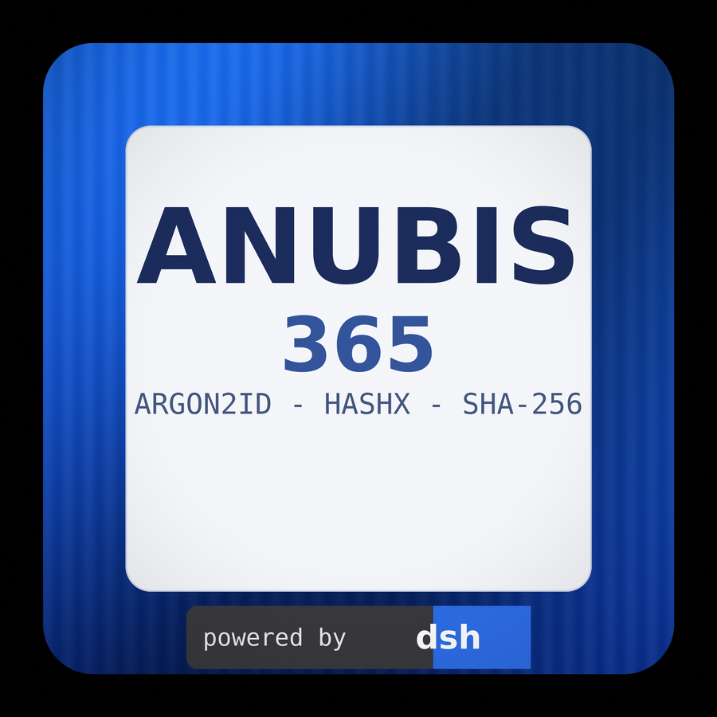
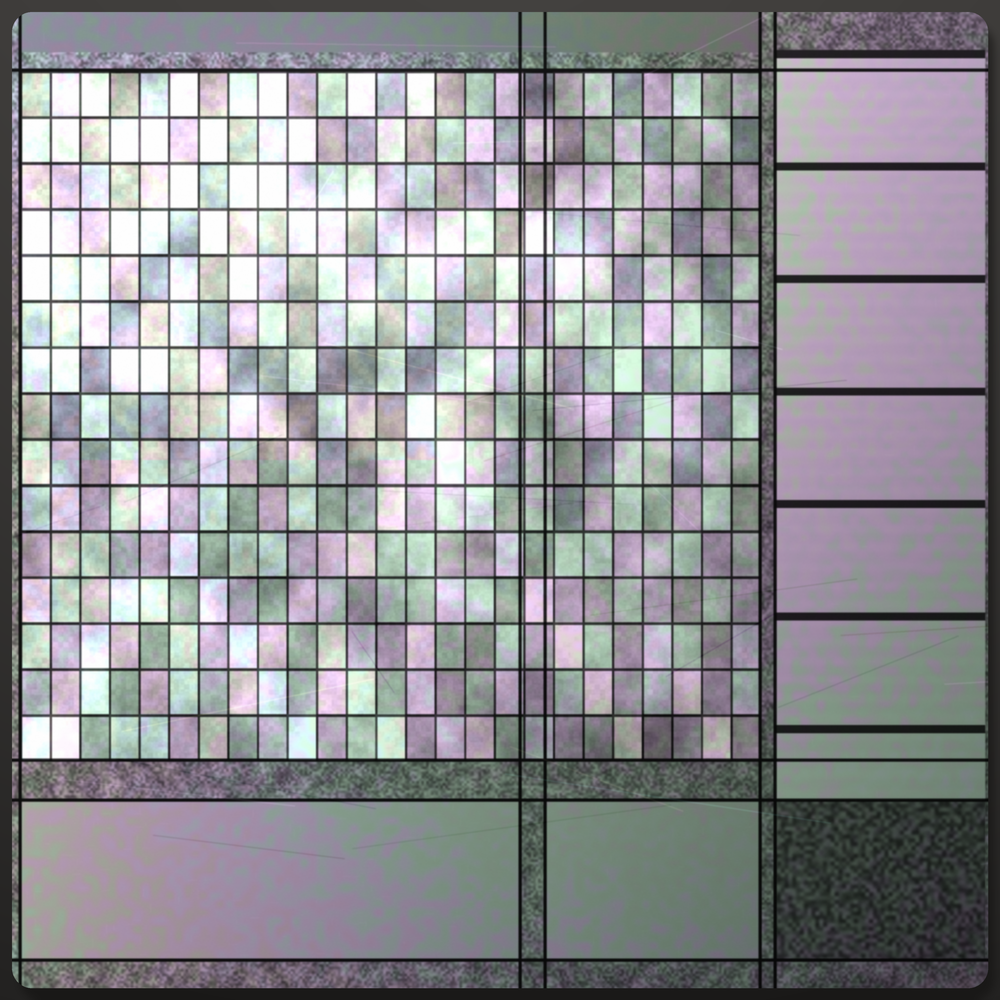
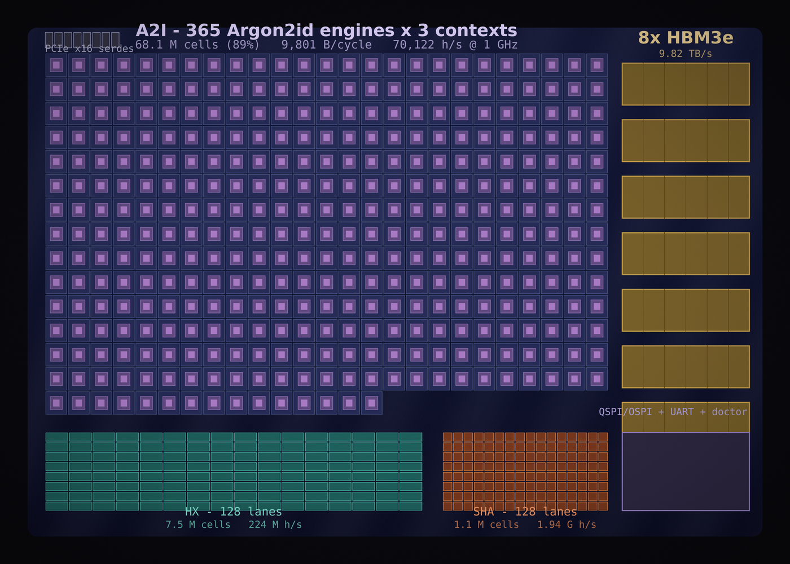

# anubis-solver


<table>
<tr>
<td align="center"><br>
<sub>the badge</sub></td>
<td align="center"><br>
<sub>the die, delidded</sub></td>
<td align="center"><br>
<sub>floorplan: 365 Argon2id engines + 8x HBM3e</sub></td>
</tr>
</table>

**Beyond** is the hardware half of this repository, in [`beyond/`](beyond/). It is a
real design point: 365 Argon2id engines
x 3 contexts behind eight HBM3e stacks (70,122 h/s measured), plus 128 HashX
lanes, 128 SHA-256 lanes and a self-test. Renders are generated by
`beyond/tools/render_chip_art.py` from the measured numbers, not drawn by hand.

A C proof-of-work engine with a Python face, for solving
[TecharoHQ/anubis](https://github.com/TecharoHQ/anubis) challenges. It does the
same flow a browser does — fetch the challenge page, compute the proof-of-work,
GET `pass-challenge`, keep the auth cookie — with the hot loops in hand-written
assembly and optional GPU backends.

> **Built entirely by [DeepSeek V4.1 Flash](https://huggingface.co/deepseek-ai/DeepSeek-V4.1-Flash-1017)**
> in [DeepSeek Harness (DSH)](https://github.com/deepseek-ai/deepseek-harness).

> **Authorized use only.** Running this against a site circumvents the bot
> mitigation its operator deliberately installed. Use it on systems you own or
> have explicit permission to test. See [SECURITY.md](SECURITY.md).

## Highlights

- **All five Anubis algorithms**: `fast`, `slow`, `sha256` (WASM), `argon2id`
  (WASM) and `hashx` (WASM), byte-exact against every Anubis release.
- **CPU kernels**: hand-written AVX2, SHA-NI, AVX-512 and AArch64 NEON/SHA-2
  assembly, with runtime dispatch down to a portable C fallback.
- **GPU backends** (all opt-in except SHA-256): CUDA, oneAPI Level Zero,
  Vulkan — for SHA-256, Argon2id and HashX. OpenCL host is in place but not
  wired yet.
- **Three interfaces**: Python library + CLI, a public C/C++ header, and the
  shared library on its own.
- **Every GPU hit is re-verified** with the CPU reference; a mismatch silently
  falls back, so a broken driver cannot produce an invalid proof.

## Quick start

```bash
make                       # builds ./libanubis_solver.so
python3 -c "import anubis_solver; print(anubis_solver.__version__)"
```

```python
from anubis_solver import AnubisClient

with AnubisClient("http://127.0.0.1:8923") as client:
    r = client.get("/")            # loads, solves, retries automatically
    print(r.status_code)
```

```bash
python3 anubis_solver.py http://127.0.0.1:8923 --threads 8
python3 examples/basic.py http://127.0.0.1:8923
```

C and C++:

```c
#include <anubis-solver.h>

uint64_t nonce; char hex[65]; double ms;
anubis_solve_nibbles("challenge", 4, 0, 0, 0.0, &nonce, hex, &ms);
```

```bash
cc  demo.c   -Iinclude -L. -lanubis_solver -Wl,-rpath,"$PWD" -o demo && ./demo
c++ demo.cpp -Iinclude -L. -lanubis_solver -Wl,-rpath,"$PWD" -o demo && ./demo
```

## Documentation

New here? [BEGINNER.md](BEGINNER.md) walks from build to first request.

| page | what it covers |
|---|---|
| [docs/python.md](docs/python.md) | Python API: solver, challenges, client, sessions |
| [docs/c-api.md](docs/c-api.md) | C/C++ header, C ABI, dlopen, return codes |
| [docs/cli.md](docs/cli.md) | command line |
| [docs/gpu.md](docs/gpu.md) | CUDA / Level Zero / Vulkan / OpenCL backends and env vars |
| [docs/troubleshooting.md](docs/troubleshooting.md) | common build and runtime errors |
| [docs/development.md](docs/development.md) | layout, build, kernel regeneration, tests |
| [SPEED.md](SPEED.md) | measured throughput, per tier and per version |

## Layout

### Other languages

Besides the Python library at the top of the repository, `bindings/` has thin
wrappers over the same `libanubis_solver.so`: a **Node** one using koffi FFI (no
native addon, no build step) and a **Go** one using cgo. Both expose
introspection, the SHA-256 helpers, all five algorithm families and verification,
and both ship with tests that run against the real library:

```bash
(cd bindings/node && npm install && node test.js)
(cd bindings/go && go test ./...)
```

### Configuration: `make config`

Before building, ask the machine what it is:

```
$ make config
anubis-solver build configuration
==================================================================
1. GPU architecture
   detected : Tesla T4 (7.5 -> sm_75)
   target   : sm_75 (T4 / RTX 20xx)
   SASS     : measured reference exists - 7 file(s) for sm_75
              the build still compiles CUDA C for sm_75; the SASS is what
              that compilation was measured against (see SPEED.md)
   nvcc     : /usr/local/cuda/bin/nvcc

2. CPU architecture
   detected : x86_64

3. CPU features
   AVX2       yes
   AVX-512F   no
   SHA-NI     yes
   ...
   best SHA-256 path: src/cpu/shani.s (SHA-NI, 1 way) + src/cpu/avx2.s
==================================================================
wrote config.mk
```

It writes `config.mk` (generated, per machine, git-ignored), which sets the
`-arch=` passed to `nvcc` and records which SIMD path is the fastest available.
On a machine with no NVIDIA GPU it reports that and the CUDA backend is skipped;
on a GPU with no shipped SASS it still builds, from the `.cu` sources, and says
so rather than implying the SASS exists.

Overrides win over detection:

```
make config CUDA_ARCH=sm_86 CPU_SIMD=avx2
make config CONFIG_ARGS=--ask      # show the answers, confirm before writing
```

`make` prints a one-line reminder if `config.mk` is missing, and builds with
defaults so nothing breaks for anyone who skips it.

```
include/anubis-solver.h  public C/C++ API
anubis_solver.py         Python library (ctypes), requests client, CLI
src/core/anubis_solver.c   C core: hashing, search loop, backend dispatch
src/hashx/hashx.c/.h       HashX generator, interpreter, x86-64/AArch64 JITs
src/cpu/*.s                AVX2, SHA-NI, AVX-512 and NEON SHA-256 kernels
src/cuda/*.cu              CUDA backends (SHA-256, Argon2id, HashX)
src/levelzero/*.c          Level Zero backends
src/levelzero/*.cl         their OpenCL C kernels (embedded SPIR-V)
src/vulkan/vulkan.c        Vulkan backends
src/vulkan/*.comp          their GLSL kernels (embedded SPIR-V)
src/opencl/                portable OpenCL host (not wired yet)
src/sass/                  NVIDIA SASS for the Tesla T4 SHA-256 kernel, and the
                           Kaggle job that produces and benchmarks it
third_party/argon2/      reference Argon2id (CC0-1.0 / Apache-2.0)
tests/                   unit, local end-to-end, version matrix, CVE harness
examples/                Python, C and C++ samples
bindings/node/           Node bindings (koffi FFI, no build step)
bindings/go/             Go bindings (cgo, links the .so)
tools/                   kernel generators, build scripts, benchmarks
results/                 raw benchmark JSON
```

## Build

```bash
make                 # libanubis_solver.so
make test            # unit tests
make clean
make CUDA=0          # force-skip CUDA
make VULKAN=0        # force-skip Vulkan
make L0_INC=/path    # where level_zero/ze_api.h lives
```

The Python module also builds the library on first import if `make` has not
been run. Backends are auto-detected:

| found | built |
|---|---|
| x86-64 | `avx2.s`, `shani.s` (AVX-512 too when the assembler and CPU support it) |
| AArch64 | `neon.s` (ARMv8 SHA-2, runtime-checked via `HWCAP_SHA2`) |
| `nvcc` | CUDA backends |
| `level_zero/ze_api.h` | Level Zero backends |
| `vulkan/vulkan.h` | Vulkan backends |
| `glslangValidator` | only to regenerate the Vulkan SPIR-V (`make shader`) |

```bash
pip install -r requirements.txt   # requests; curl_cffi and argon2-cffi optional
```

## Supported challenges

| `rules.algorithm` | primitive | difficulty unit | status |
|---|---|---|---|
| `fast` | SHA-256(`challenge` + decimal nonce) | leading zero hex nibbles | ✅ |
| `slow` | same primitive, different client implementation | nibbles | ✅ |
| `sha256` (WASM) | SHA-256(raw challenge + uint32 nonce) | leading zero bits | ✅ |
| `argon2id` (WASM) | Argon2id(password=challenge, salt=u64 nonce) | leading zero bits | ✅ |
| `hashx` (WASM) | HashX program derived from the challenge | leading zero bits | ✅ |

Byte-exact details:

- **sha256 / argon2id / hashx**: the 32-bit nonce is little-endian when the last
  decoded challenge byte is `>= 0x80`, big-endian otherwise. Argon2id encodes it
  as a 64-bit salt with the same byte order.
- **argon2id parameters**: Argon2id v1.3, `m=19456 KiB`, `t=2`, `p=1`, 32-byte
  output — Rust's `argon2::Argon2::default()`.
- **hashx**: `HashX::new(challenge)`; if the generator rejects the seed, a
  little-endian u32 counter is appended and the seed retried — the port does the
  same, so client and server agree on the program.

Unknown algorithms raise `UnsupportedAlgorithm`.

### Protocol eras handled

| releases | how the challenge arrives | quirks |
|---|---|---|
| v1.12.1 – v1.16.0 | none in the page; client `POST`s `.../api/make-challenge` | requires `X-Real-IP`; the client falls back automatically |
| v1.17.0 – v1.21.3 | `{"challenge": "<hex>", "rules": {...}}` | challenge is a string, no `id` |
| v1.22.0 – latest | `{"challenge": {"id", "randomData", ...}, "rules": {...}}` | current shape; `id` is sent to `pass-challenge` |

## GPU backends

GPU use is opt-in and verified; the CPU is always available. Dispatch order:
**CUDA → Level Zero → Vulkan → OpenCL → CPU** (whichever are compiled in and
present).

| algorithm | enable with | backends |
|---|---|---|
| SHA-256 (`fast`, `slow`, `sha256`) | automatic (work-threshold gated) | CUDA, Level Zero, Vulkan |
| Argon2id | `ANUBIS_GPU_ARGON2=1` | CUDA, Level Zero, Vulkan |
| HashX | `ANUBIS_GPU_HASHX=1` | CUDA |
| HashX on Intel iGPU | `ANUBIS_L0_HASHX=1` | Level Zero |
| HashX portable | `ANUBIS_VULKAN_HASHX=1` | Vulkan |

Measured (details in [SPEED.md](SPEED.md)):

| hardware | Argon2id d8 | HashX | SHA-256 `fast` d6 |
|---|---:|---:|---:|
| 2× Tesla T4 (CUDA) | ~1750 h/s | ~70–110 MH/s | — |
| Iris Xe (Level Zero) | ~290 h/s | ~2–3 MH/s | 137 MH/s |
| Iris Xe (Vulkan) | ~330 h/s | ~3 MH/s | 105 MH/s |
| one CPU thread (laptop) | ~38 h/s | ~4 MH/s | ~10 MH/s |

The Intel-GPU HashX kernels are correct but slower than the CPU on an Iris Xe,
hence the separate flags. On a Raspberry Pi 5, V3DV is detected but compute
kernels do not verify, so everything falls back to the CPU.

Environment controls:

| variable | effect |
|---|---|
| `ANUBIS_NO_CUDA`, `ANUBIS_NO_LEVELZERO`, `ANUBIS_NO_VULKAN`, `ANUBIS_NO_OPENCL` | disable a backend |
| `ANUBIS_CPU_AFFINITY` | `pcores` (default), `off`, or a mask like `0,2,4,6` |
| `ANUBIS_CUDA_MIN_WORK`, `ANUBIS_L0_MIN_WORK`, `ANUBIS_VULKAN_MIN_WORK` | dispatch thresholds |
| `ANUBIS_CUDA_CHUNK`, `ANUBIS_L0_CHUNK`, `ANUBIS_VULKAN_CHUNK` | SHA-256 nonces per dispatch |
| `ANUBIS_CUDA_ARGON2_LANES`, `ANUBIS_L0_ARGON2_LANES`, `ANUBIS_VULKAN_ARGON2_LANES` | concurrent Argon2id hashes |
| `ANUBIS_CUDA_HASHX_CHUNK`, `ANUBIS_L0_HASHX_CHUNK`, `ANUBIS_VULKAN_HASHX_CHUNK` | HashX nonces per dispatch |
| `ANUBIS_VULKAN_DEVICE`, `ANUBIS_VULKAN_ALLOW_CPU` | device choice / allow lavapipe |
| `ANUBIS_GPU_NO_VERIFY=1` | skip the CPU re-check of GPU hits (benchmarking only) |

Argon2id needs ~19 MiB of device memory per concurrent hash (64 lanes ≈ 1.3 GB).
Every GPU result is recomputed on the CPU before it is accepted.

## Python library

```python
from anubis_solver import AnubisClient

client = AnubisClient("http://127.0.0.1:8923", threads=4)
resp = client.get("/")
print(resp.status_code, len(resp.text))

for sol in client.solutions:
    print(sol.algorithm, sol.difficulty, sol.nonce, f"{sol.elapsed_ms:.1f} ms")
```

Lower level:

```python
from anubis_solver import AnubisSolver, parse_challenge

challenge = parse_challenge(html)          # AnubisChallenge | None
solver = AnubisSolver(threads=8)
sol = solver.solve(challenge)
print(sol.nonce, sol.response, solver.verify(challenge, sol.nonce))
print(solver.gpu)                          # detected GPU backend or None
```

CLI and browser impersonation:

```bash
python3 anubis_solver.py https://example.com --impersonate chrome --threads 8
```

`curl_cffi` is optional; when impersonating, the profile's User-Agent is kept so
TLS fingerprint and UA agree. See [docs/python.md](docs/python.md) and
[docs/cli.md](docs/cli.md).

## C / C++ API

`include/anubis-solver.h` declares everything (`extern "C"`, so C++ works).
Samples: [`examples/c_demo.c`](examples/c_demo.c),
[`examples/cpp_demo.cpp`](examples/cpp_demo.cpp); reference in
[docs/c-api.md](docs/c-api.md).

## Examples

| file | shows |
|---|---|
| [`basic.py`](examples/basic.py) | fetch a protected page with the high-level client |
| [`solver.py`](examples/solver.py) | parse a challenge, solve, verify (offline) |
| [`impersonate.py`](examples/impersonate.py) | `curl_cffi` TLS/JA3 impersonation |
| [`gpu.py`](examples/gpu.py) | report GPU/affinity and solve on the GPU |
| [`c_demo.c`](examples/c_demo.c), [`cpp_demo.cpp`](examples/cpp_demo.cpp) | the C/C++ API |

```bash
python3 examples/solver.py
python3 examples/basic.py http://127.0.0.1:8923
python3 examples/gpu.py --solve
```

## Performance (CPU)

Per-tier and per-version timings: **[SPEED.md](SPEED.md)**. Difficulty 6
(`git.ffmpeg.org`'s setting, ~16.7M hashes expected), one pinned core of an
i7-1260P:

| path | `fast` | `sha256` (bits 20) |
|---|---:|---:|
| portable C | 1.56 MH/s | 1.90 MH/s |
| `shani.s` only | 5.57 MH/s | 5.65 MH/s |
| `avx2.s` + C scalar | 7.27 MH/s | — |
| `avx2.s` + `shani.s` | **7.51 MH/s** | **6.80 MH/s** |
| `avx512.s` (16-way) | 18.5 MH/s | 25.1 MH/s |

- `avx2.s`: eight candidate messages per SHA-256 compression (the nonce walk
  shares message length/padding); `avx512.s` does sixteen, with the schedule
  kept in registers and `vpternlogd` for XOR3.
- `shani.s`: Intel SHA extensions for single-block hashing; used for `verify_*`
  and when a batch cannot form.
- Dispatch on x86-64: AVX-512 16-way → AVX2 8-way → SHA-NI → portable C; on
  AArch64: ARMv8 SHA-2 → C. `ANUBIS_NO_AVX2`, `ANUBIS_NO_SHANI`,
  `ANUBIS_NO_AVX512`, `ANUBIS_NO_NEON` force lower paths for A/B tests.

Expected time by tier (one core): `fast`/`slow` light 0.1 ms, medium ~10 ms,
hard ~2 s; `sha256` similar; `hashx` 0.2 ms / 15 ms / 294 ms; `argon2id`
148 ms / 508 ms / 1.85 s. Versions up to v1.27.0 only offer `fast`/`slow`;
v1.28.0+ adds the three WASM algorithms.

On a Raspberry Pi 5 (Cortex-A76) the NEON/SHA-2 path reaches ~10.1 MH/s
(`fast`) and ~12.8 MH/s (`sha256`) per core, scaling to 40.4 / 43.2 MH/s on
four cores. The AArch64 HashX JIT does ~1.6 MH/s per core (6.35 on four).

Threading and affinity: on hybrid CPUs workers are pinned to physical P-cores
by default and the default thread count is the P-core count.
`ANUBIS_CPU_AFFINITY=off` disables pinning; an explicit mask pins to those CPUs.

## curl_cffi (browser fingerprint impersonation)

Anubis can weigh JA3/JA4H or expect the User-Agent to match the TLS stack:

```python
client = AnubisClient("https://example.com", impersonate="chrome")
```

or bring your own `curl_cffi` session. `curl_cffi` is optional.

## Hardware (Verilog)

`beyond/` contains a synthesizable reference implementation of the proof of work:
a SHA-256 core with a nonce scanner for the `fast`/`slow`/`sha256` challenges,
and a complete Argon2id datapath (BLAKE2b, H0, H′, `index_alpha`, the address
generator and the two-pass fill loop, with the 1 KiB block memory inside the
engine) for `argon2id`.

It simulates under Icarus Verilog and it really solves a challenge: given a
32-byte challenge at difficulty 4 it searched nonces on the die, found nonce 18
with 7 leading zero bits, and `argon2-cffi` reproduces the tag byte for byte.

```bash
cd beyond && make sim     # every testbench
cd beyond && make solve   # on-chip nonce search, M_COST = 64 blocks
```

The engine's memory is a flop array today, so it runs the real 19456-block
parameters only in slow simulation (~10M cycles per hash); swapping it for the
verified LPDDR6 model is the remaining work. See [`beyond/README.md`](beyond/README.md).

## CVE-2026-62314 (opt-in)

Anubis v1.22.0 .. < v1.26.0-pre1 trusts the client-controlled `X-Original-URI`
header in `PathChecker.Check()`, so a request can match the shipped
`keep-internet-working` ALLOW rules and skip the challenge.

This is an exploit of a known vulnerability, so the client:

- does **not** use it by default (`use_cve=False`);
- only tries it after a challenge was issued;
- only targets loopback/private addresses unless `allow_remote_cve=True`;
- emits a warning when it fires.

`tests/test_cve_2026_62314.py` verifies it against locally built releases;
results in [`results/cve-2026-62314.json`](results/cve-2026-62314.json).

## Tested versions

Every stable release and pre-release tag was built from source and challenged
through the algorithms it supports: **110/110 cases across all 56 tags**
(31 stable + 25 pre-release; `v1.17.0.signed` is a signing artifact and is
skipped). Raw results:
[`results/version-matrix.json`](results/version-matrix.json),
[`results/version-matrix-prereleases.json`](results/version-matrix-prereleases.json).

## Tests

```bash
make test                                 # C core vs hashlib / argon2-cffi
python3 tests/test_local.py               # full flow against a local Anubis
python3 tests/test_versions.py            # all git tags (builds each in /tmp)
python3 tests/test_cve_2026_62314.py      # CVE-2026-62314 across tags
```

`test_local.py` and the version matrix build Anubis from a checkout
(`ANUBIS_SRC`, default `../anubis`) and start it in front of a throwaway
backend. Building Anubis from a fresh clone needs its generated assets and WASM
modules:

```bash
cd anubis
npm ci --ignore-scripts
export PATH="$PWD/node_modules/.bin:$PATH"
./lib/challenge/preact/build.sh
./lib/challenge/challengepage/build.sh
./web/build.sh            # the wasm2js worker may fail; not needed for these tests
./xess/build.sh
rustup target add wasm32-unknown-unknown
bash wasm/scripts/build_wasm.sh
go build -o /tmp/anubis-build/anubis ./cmd/anubis
```

## License

Original code is MIT (see [LICENSE](LICENSE)). `src/hashx/hashx.c` is a port of
tevador/hashx and remains **LGPL-3.0**; `third_party/argon2` is CC0-1.0 /
Apache-2.0. See [THIRD_PARTY_NOTICES.md](THIRD_PARTY_NOTICES.md) before
redistributing binaries.

[](https://huggingface.co/deepseek-ai/DeepSeek-V4.1-Flash-1017)
[](https://github.com/deepseek-ai/deepseek-harness)
